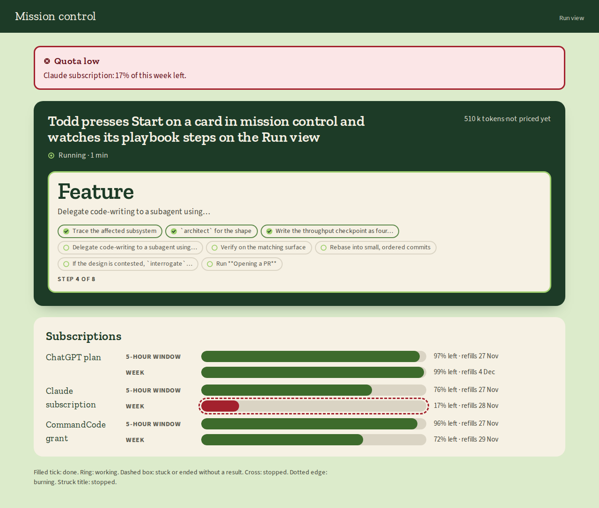
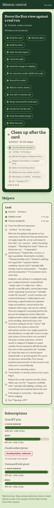

# The Run view against a real run

This is the proof for the card's first two done checks: the screen read beside the run's own trace,
not beside a fixture. The machine ran a card down its real workflow and wrote its real live file, a
real `state.db` and a real `trace.duckdb`; the screen was then served from that file and each value
on it was paired with the trace row for the same moment.

## What ran

| Part | Real or stand-in |
| --- | --- |
| Workflow, stages, storage, trace, live writer, task tools, memory | the machine's own code (`machine/flow/`) |
| Model | `MastraLanguageModelV2Mock` from `@mastra/core/test-utils/llm-mock`, the stand-in `machine/flow/workflow.test.mjs` uses |
| The Lead's two tool calls | real tool calls: `choose_playbook`, then `task_update` on `playbook_1` |
| Shipping, review, check, preflight | the stand-ins `machine/flow/workflow.test.mjs` uses; no real pull request |
| Quota readings | the real readers, real endpoints |

A paid model call and a real pull request are the two things this environment must not do, so the
drive script swaps exactly those. Everything the screen reads is the machine's own output.

```sh
node scripts/proof-run.mjs
# -> status success, 45 live lines, byType {stage 32, run 1, agent 2, tool 4, tasks 2, model 3, outcome 1}
cd dashboard && FLOW_DIR=../.artifacts/flow/proof-JUL-361/run npx next start --port 4314
curl http://127.0.0.1:4314/control/api/run-view
```

`scripts/proof-run.mjs` is the driver, so a reviewer reruns this rather than trusting the transcript. It
writes the run folder, the `state.db` and the `trace.duckdb`. The trace copy is opened read-only; the
original is never opened, because a live run holds it.

## What the screen said

Two reads over HTTP, identical bodies for the whole run object:

| Field | Screen |
| --- | --- |
| status | `finished` |
| stage | `cleanup` → "Clean up after the card", done |
| step | "`architect` for the shape.", step 2 of 8, 1 done |
| tokens | 90 |
| dollar estimate | `null` (see caveats) |
| helper | Lead, done, 2 actions, 8 tasks |
| warnings | none |
| subscriptions | ChatGPT fresh 100% / 80% left, Claude `unknown` "sign-in expired", CommandCode fresh 97% / 99% left |

`runningMs` 2,108 ms for a run that began at 03:23:55.098Z and ended at 03:23:57.206Z. The times in
this document come from the run recorded while the card was open; a rerun moves them by a few
milliseconds and leaves every delta below at 0–1 ms.

### The screen as it looked

Both pictures come from that same run, served on port 4314 at 03:23Z.



Laptop, 1280 wide.



Phone, 390 wide.

## Pairing each action with the trace

The Lead's actions, as the screen lists them (newest first) beside the `tool_call` span for the same
call. Both sides read the same `spanId`, `callId` and clock.

| Screen (newest first) | Screen start / end (ms) | Trace `tool_call` start / end (ms) | Delta |
| --- | --- | --- | --- |
| Update a task (`task_update`) | 1795404235645 / 1795404235658 | 1795404235645 / 1795404235658 | 0 / 0 |
| Choose playbook (`choose_playbook`) | 1795404235304 / 1795404235324 | 1795404235303 / 1795404235324 | 1 / 0 |

The agent run they belong to:

| Screen | Trace |
| --- | --- |
| Lead, `flow-build`, 03:23:55.122Z → 03:23:55.776Z, 90 tokens | one `agent_run` span, `entityId` `flow-build`, 03:23:55.121Z → 03:23:55.776Z |

Tokens agree because both sides count the same three `model_inference` spans, one per Lead turn,
each reporting 10 in and 20 out. The trace also carries three `model_generation` spans above them
with the same usage, so a naive sum over both types would triple count; the writer counts the
inference only and the pairing collapses the trace the same way.

## Where "step 2 of 8" came from

Not from a heuristic. The machine publishes the Lead's task list as a `tasks` event twice in this
run, once after `choose_playbook` and once after `task_update`, each carrying the eight playbook
items with their statuses. At the second event `playbook_1` is `completed` and the rest are
`pending`, and `state.db` holds the same list (`mastra_thread_state`, thread
`JUL-361-PROOF/build-1`). The fold names the step the count names: one completed step means the run
is on step 2, so `run.step` is `playbook_2`'s title. The browser suite pins the same behaviour with
a step the machine marked `in_progress`.

## What a mock model proves, and what it does not

Proves: the stage code, the live writer, the task tools, the span processor, the fold, and the screen
all work on a real run's own data. Every number above came out of the machine, and the pairing is
row for row.

Does not prove: real model latency, a real token count (a mock turn always reports 10 in and 20 out,
so 90 is the true usage of these three calls and not what a builder would spend), real quota
movement during the run, or a real model's tool choices. Helper actions, step advancement and every
warning state are also driven from writer-generated scenes in `dashboard/lib/run-view.test.mjs` and
`dashboard/tests/run-view.spec.mjs`, which do not depend on a model at all.

## Reaching the Run view on the tailnet

The app listens on `127.0.0.1:4314` under `basePath: /control`. `tailscale serve status` today
forwards only `/` to another app on 4313, so `https://ovh.tail91f394.ts.net/control` returns 404
until the path is added:

```sh
tailscale serve --bg --set-path /control http://127.0.0.1:4314
tailscale serve status   # expect / -> 4313, /control -> 4314
```

That leaves the existing `/` mapping untouched, and the Run view answers at
`https://ovh.tail91f394.ts.net/control`. Running it is Todd's call; nothing in this card runs it.

## Caveats, stated rather than hidden

- **The dollar figure is null, not zero.** `mock-model-id` is not in `dashboard/lib/model-prices.js`,
  so there is no price to estimate from. A real card's model is priced there, and the screen always
  prints the word "estimate" beside the figure.
- **Claude reads `unknown`.** Its stored sign-in expired at 05:45Z and the refresh path returns
  nothing, so the bar shows `unknown` with the reason. ChatGPT and CommandCode read fresh from their
  live endpoints in the same request.

## What this run found

Four defects that no fixture had caught, each fixed at its source:

1. The fold treated only `hold` as an ending, so a run that finishes on `cleanup` read as still
   running. The machine now publishes an `outcome` event, and the fold reads the ending from it.
2. The writer published the span's label (`agent run: 'flow-build'`) as the agent's identity, so the
   screen would have shown "Agent Run: 'Flow Build'" instead of "Lead". Mastra keeps the id on
   `entityId`.
3. The task tools published their list under the phantom agent `machine`, because Mastra hands a
   tool its agent as `agent.agentId` and the code asked for `agent.id`. That split the Lead into two
   helper cards. The list now carries `flow-build`, and one card holds both the actions and the steps.
4. The step count printed without a step name, because a run whose only task write reports a
   completion has nothing marked in progress. The name now comes from the same lookup as the count,
   so "step 2 of 8" always has the step beside it.
